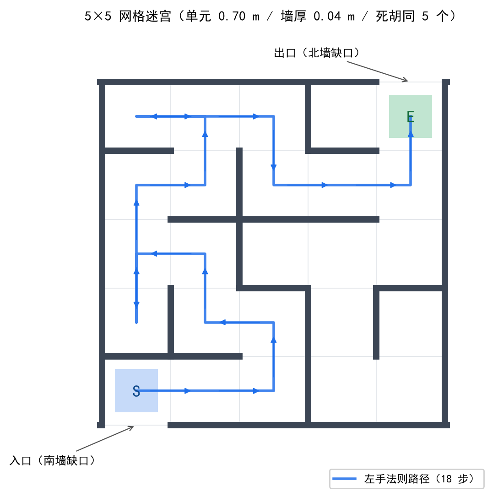
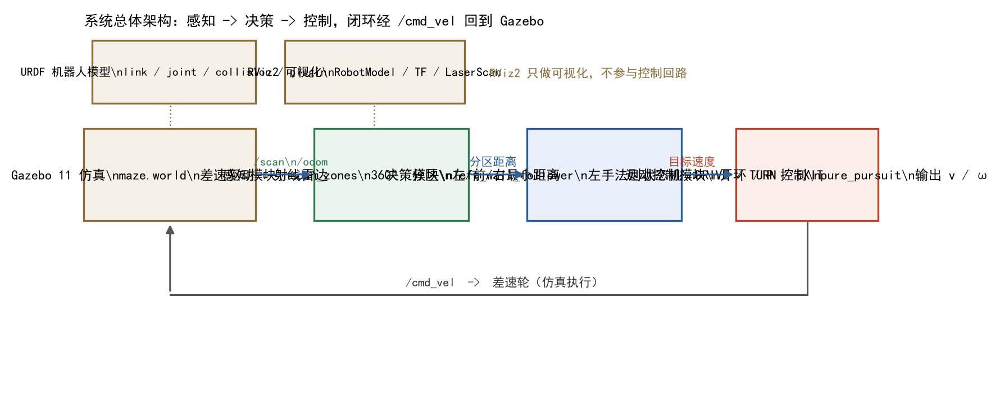
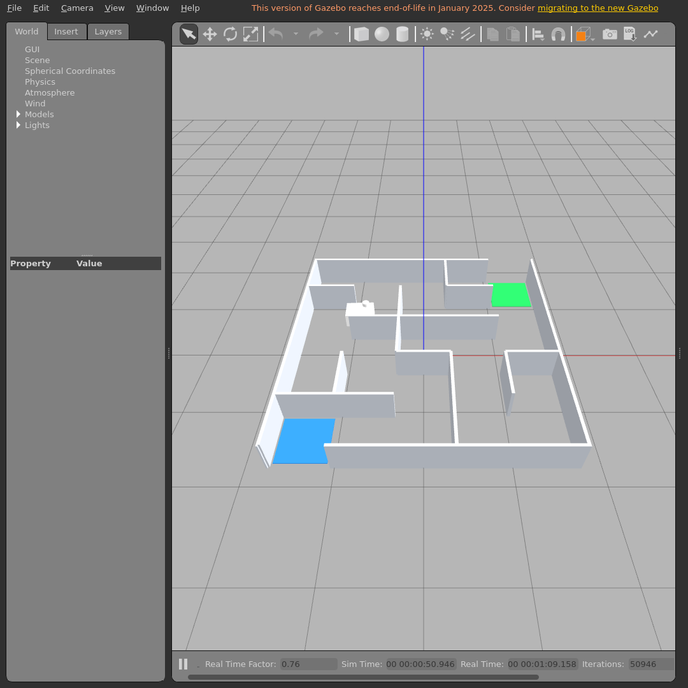
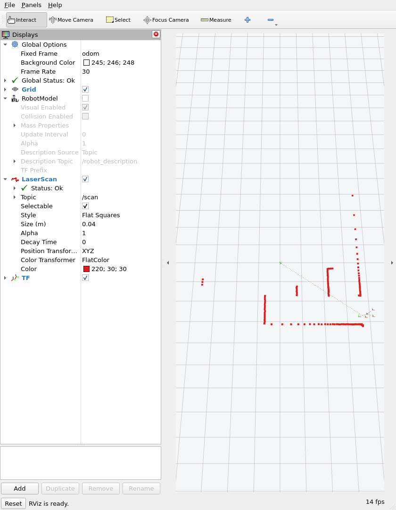

# 地老鼠走迷宫系统（MicroMouse Maze）

《机器人感知与控制综合实践》期末综合实践 · 方向 1
课程代码：S0610350 ｜ 学号：24031126 ｜ 姓名：朱酉烨 ｜ 自动化

基于 ROS 2 Humble + Gazebo 11 + RViz2 的反应式迷宫寻路系统。
不使用 SLAM 预先建图，仅依靠 `/scan` 激光雷达与 `/odom` 里程计完成
开环运动、里程计 P 闭环点到点控制、航点跟踪、雷达分区避障与左手法则寻路。

---

## 0. 效果展示

| 迷宫布局（5×5，单元 0.70 m，蓝色为左手法则路径） | 系统架构（感知 → 决策 → 控制） |
|:---:|:---:|
|  |  |

| Gazebo 运行中 | RViz2 雷达点云 |
|:---:|:---:|
|  |  |

实测：**88.17 s** 走出迷宫，行程 **12.71 m**，**14** 次格心转向，经过 **18** 个格心。
全部截图与数字来自 Ubuntu 22.04 + Gazebo 11 的真实运行会话。

---

## 1. 环境版本

| 项目 | 版本 |
| --- | --- |
| 操作系统 | Ubuntu 22.04 LTS（VMware 虚拟机） |
| ROS | ROS 2 Humble Hawksbill |
| 仿真器 | Gazebo 11.10.2（Gazebo Classic） |
| 可视化 | RViz2 11.2.x |
| 构建工具 | colcon / ament_python |
| Python | 3.10 |
| 机器人模型 | 自建差速两轮 URDF（non-TurtleBot3，与课程实验 5 的模型参数一致） |

依赖包：`gazebo`、`libgazebo-dev`、`ros-humble-gazebo-ros-pkgs`、
`ros-humble-rviz2`。

## 2. 编译

```bash
cd ~/ros2_ws
source /opt/ros/humble/setup.bash
colcon build --packages-select micromouse_maze
source install/setup.bash
```

## 3. 一键启动

```bash
source /opt/ros/humble/setup.bash
source ~/ros2_ws/install/setup.bash

# 完整演示（Gazebo + RViz2 + 左手法则 + 轨迹记录）
ros2 launch micromouse_maze maze_sim.launch.py

# 分项验证
ros2 launch micromouse_maze maze_sim.launch.py mode:=open_loop      # 开环直行/转向
ros2 launch micromouse_maze maze_sim.launch.py mode:=p_control      # P 控制 + 6 航点
ros2 launch micromouse_maze maze_sim.launch.py mode:=avoid          # 反应式避障
ros2 launch micromouse_maze maze_sim.launch.py mode:=pure_pursuit   # 拓展：纯追踪
ros2 launch micromouse_maze maze_sim.launch.py mode:=none           # 只起仿真与可视化

# 无图形界面（服务器上跑算法、采数据）
ros2 launch micromouse_maze maze_sim.launch.py gui:=false rviz:=false
```

一条 launch 按时间轴依次启动：gzserver/gzclient → `robot_state_publisher`
→ `spawn_entity.py`（+5 s）→ RViz2（+6 s）→ `scan_zones` 与
`trajectory_recorder`（+8 s）→ 按 `mode` 选定的算法节点（+9 s）。
无需多终端逐条敲命令。

常用检查命令：

```bash
ros2 topic list
ros2 topic echo /scan --once
ros2 topic echo /odom --once
ros2 run rqt_graph rqt_graph
```

## 4. 目录结构

```
micromouse_maze/
├── package.xml                 功能包清单与依赖
├── setup.py / setup.cfg        入口点与数据文件安装规则
├── config/params.yaml          全部算法参数（阈值、增益、限速、航点）
├── urdf/micromouse.urdf        差速两轮 + Gazebo 差速/雷达插件
├── worlds/maze.world           5x5 网格迷宫（由 maze_model.py 生成）
├── worlds/maze_layout.json     布局元数据（墙段数、死胡同、左手法则步数）
├── launch/maze_sim.launch.py   一键启动文件
├── rviz/maze.rviz              RViz2 显示配置（Grid / LaserScan / TF）
├── tools/                      离线整定工具（不进安装）
│   ├── find_layout.py          按"左手法则可解 + 步数适中"筛选迷宫布局
│   └── sim_offline.py          自写射线仿真 + 运动学积分，秒级验证控制律
└── micromouse_maze/            Python 节点源码
    ├── maze_model.py           迷宫模型：DFS 生成、左手法则校验、射线仿真、SDF 输出
    ├── left_hand_core.py       左手法则核心（无 ROS 依赖，可离线跑）
    ├── left_wall_follower.py   ROS 节点封装（20 Hz 定时器）
    ├── scan_zones.py           /scan 分区（前 / 左 / 右）
    ├── open_loop_drive.py      开环直线 / 原地转向
    ├── odom_p_controller.py    里程计 P 控制 + 航点序列
    ├── reactive_avoid.py       反应式避障
    ├── pure_pursuit.py         拓展：纯追踪轨迹跟踪
    ├── trajectory_recorder.py  记录 /odom 轨迹到 CSV
    └── gen_maze_world.py       由布局生成 .world（改 seed 即可换迷宫）
```

## 5. 迷宫与算法参数

迷宫按 MicroMouse 竞赛规则搭网格，而非"几道墙的房间"：

| 项目 | 取值 |
| --- | --- |
| 网格 | 5 × 5 单元 |
| 单元边长（通道净宽） | 0.70 m |
| 墙厚 / 墙高 | 0.04 m / 0.45 m |
| 内部墙 | 25 段，5 个死胡同 |
| 入口 / 出口 | 西南角单元南墙缺口 / 东北角单元北墙缺口 |
| 起点位姿 | (-1.40, -1.40)，朝北（yaw = +90°） |

`/odom` 由 gazebo_ros_diff_drive 插件按世界坐标发布（初始值即 spawn 位姿），
因此格心判据、航向闭环与出口判定全部使用世界坐标：
出口判据为 y > 1.75 m（外墙内表面）。

核心参数（`config/params.yaml` 的 `left_wall_follower` 段）：
`v_nom 0.28 m/s`、`turn_w 1.45 rad/s`、`wall_th 0.55 m`、
`arrive_tol 0.04 m`、`slow_dist 0.30 m`、`kp_head 2.0`、`kp_lat 1.2`。

换迷宫：修改 `micromouse_maze/gen_maze_world.py` 里的 `DEFAULT_SEED`
后执行 `ros2 run micromouse_maze gen_maze_world`，脚本会重新生成
`worlds/maze.world` 并打印"左手法则 N 步、可解=True/False"。
`tools/find_layout.py` 可批量筛选出可解且步数合适的种子。

## 6. 实测结果

| 实验 | 结果 |
| --- | --- |
| 开环运动 | 7 个步骤，时长误差 < 0.10 s |
| P 控制 6 航点 | 平均到位误差 0.024 m（全部 ≤ 0.030 m） |
| 反应式避障 | 前方 0.44 m 触发 1 次，停车并转向 |
| 左墙跟随 | 88.17 s、12.71 m、14 次格心转向、18 个格心，终点 (1.402, 1.901) |

## 7. 已知局限

* 左手法则只对单连通（无环）迷宫保证可达；竞赛迷宫含环时可能绕圈，
  后续可用 flood-fill 决策替代。
* 反应式避障"恢复直行"的判据在窄通道中偏保守，会原地往复。
* 纯追踪在窄通道拐角处不收敛（前视距离与单元边长比例未匹配）。

## 8. AI 工具使用声明

AI 工具仅用于：辅助生成 Python 代码骨架、报告文字润色、示意图绘制。
**URDF 插件参数、雷达分区角度与阈值、P 控制增益、状态机判据、
迷宫墙体坐标与单元尺寸均经过本人在 Gazebo 中实机调试与修改**；
所有仿真截图、终端日志、轨迹 CSV 均来自本人实际运行的 Gazebo + RViz2 会话。

## 9. 开源仓库

本仓库：`https://github.com/<用户名>/micromouse-maze-ros2`（上传后把此行替换为真实地址）

课程：《机器人感知与控制综合实践》 (2026-2027-1)-S0610350-01 方向 1「地老鼠走迷宫」

## 10. 许可证

MIT License，见 [LICENSE](LICENSE)。
